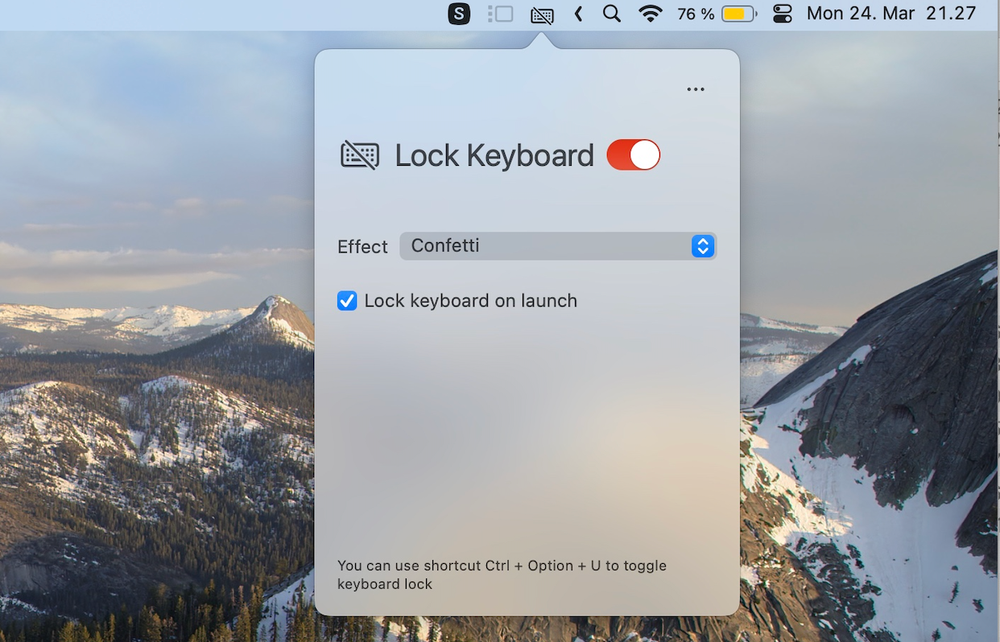

Independent keyboard game revived 21 Oct 2026. Canonical path: `~/calm/projects/p-baby-keyboard` (moved with full Git history from the deprecated daria folder). Browser companion: `../p-baby-button-locker`, route `/keyboard`.

Original Find the letter: launch BabyKeyboardLock → **Подготовить «Найди букву» для Даши** (sets Russian speech, Russian letter targets, no English translation) → read the visible unlock shortcut → turn on **Lock Keyboard** yourself. Preparing selects the original gamified random-word mechanism and enables word cards; it never locks automatically. Correct physical keys earn the original word/story reward. Unlock: **Ctrl + Option + U**; **Exit App** is always visible. Accessibility permission is required for OS locking.

Compile without installing or locking: `make build-only`. Open the built app only when ready: `open "build/revival/Build/Products/Debug/BabyKeyboardLock Debug.app"`. Native locking and speech require actual parent/device verification; a build is not proof of them.

# BabyKeyboard Lock

Baby keyboard lock is a Macos app that can lock your keyboard, while your toddlers or kids can still have fun with it. Find more on official site https://keyboardlock.app/



## Table of Contents

- [Features](#features)
- [Development](#development)
  - [Building Locally](#building-locally)
  - [Installing Certificates on Another Mac](#installing-certificates-on-another-mac)
- [TODO](#todo)
- [Credits](#credits)

## Features

- Lock your keyboard to prevent unwanted inputs, including media keys and Power button
- Configurable fun effects, confetti, read the pressed key, read a word that starts with the pressed key, more effects coming.
- No visible window is created, so you can still read your webpage or movie as normal
- A Menu bar only App, and you can toggle keyboard lock with a global shortcut

## Development

### Building Locally

To build and deploy the app locally:

```bash
make deploy
```

This will clean, archive, export, and install the app to `/Applications/`.

### Web App Setup (Next.js)

1. Create env file:
```bash
cp web/.env.local.example web/.env.local
```

2. Fill Supabase keys in `web/.env.local`:
- `NEXT_PUBLIC_SUPABASE_URL`
- `NEXT_PUBLIC_SUPABASE_ANON_KEY`

3. Install and run:
```bash
make web-install
make web-dev
```

4. Build/start:
```bash
make web-build
make web-start
```

5. Optional S3 media storage (images/audio/video):
```bash
make s3-bucket-setup S3_BUCKET=<bucket> AWS_REGION=us-east-1 S3_PREFIX=baby-keyboard
make s3-media-sync S3_BUCKET=<bucket> S3_PREFIX=baby-keyboard
```
and set in `web/.env.local`:
- `MEDIA_STORAGE_PROVIDER=s3`
- `AWS_S3_BUCKET=<bucket>`
- `AWS_REGION=<region>`
- `AWS_S3_PREFIX=baby-keyboard`
- optional CDN/custom host: `MEDIA_STORAGE_BASE_URL=...`

6. Optional warning fix:
```bash
cd web && npm i baseline-browser-mapping@latest -D
```

7. Generate pre-synth audio files:
```bash
uv run python scripts/generate_presynth_audio.py --base-url "https://<bucket>.s3.<region>.amazonaws.com" --url-prefix "baby-keyboard"
```

### Installing Certificates on Another Mac

If you need to build the app on a different Mac (e.g., another family member's computer), you'll need to transfer the code signing certificate:

**On the original Mac (with the certificate):**

1. Open **Keychain Access**
2. Find the certificate: "Apple Development: petr.b.lavrov@gmail.com (8BH632TKSD)"
3. Right-click → **Export** → Save as `.p12` file
4. Set a strong password when prompted
5. Transfer the `.p12` file securely to the other Mac (via AirDrop, USB drive, etc.)

**On the new Mac:**

1. Double-click the `.p12` file to import it
2. Enter the password you set
3. Open **Keychain Access**
4. Find the imported certificate
5. **Double-click** the certificate → Expand **"Trust"** section
6. Change "When using this certificate:" to **"Always Trust"**
7. Close and enter your password to save

Now `make deploy` should work on the new Mac!

**Security note:** Delete the `.p12` file after importing, and don't share it via unencrypted channels.

## TODO

- ~~show window on launch~~
- ~~hide docker icon, only need menu bar~~
- ~~https://developer.apple.com/documentation/uikit/creating-custom-symbol-images-for-your-app~~
- Adding more effects
- whitelist / Blacklist by key codes
- Temporary lock by holding Fn ?
- Accessibility improvement
- Notarizing https://developer.apple.com/documentation/security/notarizing-macos-software-before-distribution
- Unit test

## Credits

- Sound effects are downloaded from https://freesound.org/
- This app is inspired by https://github.com/kfv/keylock/

Daria’s prepared Russian Find path uses the inspected simple artwork style and filters known English-text/meaning-mismatch source art through `DariaArtworkPolicy` before media selection and rendering. Original files and archived modes remain available. Reproduce the39-stem selector check with `swiftc BabyKeyboardLock/utils/DariaArtworkPolicy.swift ai-notes/native-art-policy-check.swift -o build/native-art-policy-check && build/native-art-policy-check`.
